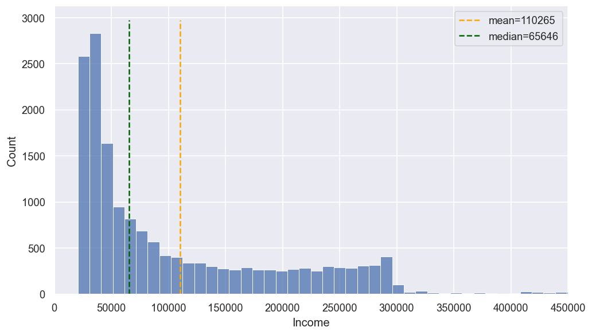

## Introduction

In this note I will cover how I was able to produce a general continuous solution to a problem that is equivalent to finding the **de Finetti-Kolmogorov-Nagumo generalized mean** generators. I will describe the exact order in which I arrived at the results, the motivation behind each step, and some extension results I am still working on. As at the time of researching this topic I was not aware of several key concepts, such as the generalized mean, I will point out some connections to related literature at the end of this article.

## Motivation

The idea came to me when I was working on an income prediction problem. The chart below shows a synthetic data distribution that imitates the kind of income distribution I had to work with:

This distribution is generally not nice: it is highly skewed, with a very heavy right tail and significant excess kurtosis. Additionally, we see a sharp drop off in density at 300k, yet with some exceptional observations above that threshold. Clearly, some data pre-processing issues, such as flawed filtering, were at play.

The best-fit distribution turned out to be a double Pareto-lognormal (dPlN) one. It can be achieved by having the tails of a lognormal distribution be rescaled by independent Pareto-distributed factors. Interestingly enough, this is exactly the distribution of the value of a geometric Brownian motion at an exponentially-distributed time [@ReedJorgensen2004]. Assuming an individual's income evolves as a geometric Brownian motion (for example, assume the income is determined by equity, and impose the assumptions of the Black-Scholes model on the equity market), and that our observation time of the income is exponentially-distributed relative to their "start of life" ($t_0$), dPlN is the exact distribution we would expect.

Either way, it was also difficult to predict this income given the data I had access to. Naturally, I set it up as a regression problem with MSE as the loss. The trained model was mostly predicting the train sample mean income – that is exactly what theory says is optimal for low-information models. However, occasionally it detected some actual anomalies in the data! So, while the model was mostly useless on its own, using its scores within an ensemble model could be very useful.

Nonetheless, looking at the chart above, we see that the mean is 110k. So, while I saw the "default" level of income to be much lower and closer to 20k or 30k, as that is the baseline for what a person earns in the studied economy, the model assumes the individual earns quite a high level of income instead. What immediately seems to be the cause of it is the heavy right tail of the distribution. The simplest solution to this – switch to MAE for loss, so that by default the model predicts the median instead. Alternatively, we could apply a logarithm, Box-Cox, or other transforms. Either way, the model still predicts 65k+ by default, that is closer to, but still not at the value I would like.

It really bothered me that the default value the model chose was much higher than what to me seemed to be the natural default choice, such as 25k. And while I could try replacing the default predictions by hand, I wanted to see if it was possible to make the model learn to do it on its own. So, to restate the question:

> How can we make a low-information regression model train such that, when it has insufficient information to make a good guess, predict any pre-selected value?

## Producing Arbitrary Default Predictions: General Approach

The idea I came up with to solve this problem was quite neat:

0. Select a point of interest we want to make a default choice, call it an "anchor"
1. **[\*]** Choose an invertible transformation such that the anchor is mapped to the mean of the new distribution
2. Train a low-information model against the transformed target <u>with MSE as loss</u>
3. On inference, apply the inverse transform to the model's predictions

The reason why this should work is that when we have no information about the target, the theoretically optimal decision is to predict the mean. Since the mean after the transformation corresponds to the anchor, doing the inverse-transform should yield the anchor by default. Interestingly, such an idea has already been stated, for instance in [@Carvalho2016, section 4.1].

The idea is overall not perfect. The transition from population mean to sample mean is not a significant problem due to LLN (more details in future write-ups). However, if the model is able to predict the target on rare occasions, the default prediction may be different from the unconditional mean. To be more precise, let's consider an example.

::: {.callout-tip title="Example: unconditional mean vs default prediction with low information"}

Assume that $X$ is a Bernoulli random variable with $p := \mathbb{P}(X = 1)$ – this represents the features the model observes. Additionally, assume there is a random variable $Z$ that is independent of $X$, and $\mathbb{E}Z = 1$. Finally, define $Y = Z + \alpha XZ, \ \alpha \in \mathbb{R}$ – this represents the target the model is trained to predict. Note that

$$
    \mathbb{E}[Y|X=0] = \mathbb{E}Z = 1, \quad \mathbb{E}[Y|X=1] = \mathbb{E}[(1+\alpha)Z] = 1 + \alpha,
    \\
    \mathbb{E}[Y] = (1-p) \mathbb{E}[Y|X=0] + p\mathbb{E}[Y|X=1] = 1 + p \alpha
$$

So, here the default value is $\mathbb{E}[Y|X=0] = 1$, but the unconditional mean is $1 + p \alpha$. If the frequency with which the model identifies an outlier, $p$, is high, meaning the model is not actually low-informational, the difference becomes significant. Analogously, if the occasionally identified by the model anomalous values are very large, $\alpha \gg 1/p \gg 1$, the default value will again be significantly different from the unconditional mean.
:::

In other words, the approach described above may work for not only information-less models that predict only 1 value, but also for other low informational models, but with some caveats. The possible solution to this will be described in future research notes. Nonetheless, the question of whether this approach is even feasible in general is interesting on its own without assuming its correctness.

## Mean Anchoring

### Definition

The key problem in that algorithm is how step 1, noted by **[\*]**, can be implemented. Let's introduce some definitions and notation for what this problem is:

::: {.callout-note title="Definition 1 (Mean-Anchoring Transform)"}
Assume an arbitrary random variable $X: \Omega \to \mathbb{R}$ and $m \in \mathbb{R}$. A **Mean-Anchoring transform** of $X$ with **anchor** $m$ is a measurable injection $g:\mathbb{R} \to \mathbb{R}$ such that $g(X) \in L^1$ with
$$
    \mathbb{E}[g(X)] = g(m).
$$
The collection of all such mappings is written as $\mathbf{MAT}[X,m]$.
::: 

The intuition behind the naming: the transformation $g$ basically moves the point of interest $m$ while shifting the center of mass of the distribution to where $m$ lands, as if making $m$ an "anchor" and "anchoring" the entire distribution on it.

This idea is directly connected with the generalized mean:

::: {.callout-note title="Definition 2 (de Finetti-Kolmogorov-Nagumo Generalized Mean)"}
Assume an arbitrary random variable $X: \Omega \to \mathbb{R}$. A **de Finetti-Kolmogorov-Nagumo Generalized Mean** is 
$$
    M_g[X] := g^{-1}\left(\mathbb{E}[g(X)]\right),
$$
where $g:\mathbb{R} \to \mathbb{R}$ is a continuous injection.
::: 

In this context, we can call $g$ a **generalized mean generator**. Note that $g \in \mathbf{MAT}[X, M_g]$. Thus,

> The problem of identifying continuous Mean-Anchoring transforms is equivalent to finding all admissible generators $g$ of the de Finetti-Kolmogorov-Nagumo generalized mean $m := M_g[X]$, given $X$ and $m$.

I realized this reformulation after developing the theory of mean anchoring. Following the timeline of how I explored this topic, the connection to related literature will be noted at the end of this note.

### Properties

The linearity of expected value gives us an immediate result:

::: {.callout-warning title="Proposition 1 (Closure under affine transformations)"}
Let $X$ be any random variable and $g \in \mathbf{MAT}[X,m]$ for a point $m \in \mathbb{R}$. Then
$$
    \{g': g'(x) = a + b \cdot g(x), \ a,b \in \mathbb{R}, \ b \neq 0\} \subseteq \mathbf{MAT}[X,m].
$$
::: 

Consequently, without loss of generality, we can restrict our search to transforms that make the mean equal to 0, and afterwards add a constant to shift the mean. Additionally, we can rescale the output to get specific variance (e.g., divide by standard deviation for standard scaling).

I realised several things quite quickly:

- The trivial case is not so interesting. When $X$ is trivial, i.e. $X \stackrel{a.s.}{=} x$, as $g$ is injective, the only possible anchor ($\mathbf{MAT}[X,m] \neq \varnothing$) is $m = x$, and every measurable injection $g$ works.
- If we allow $g$ to be measurable but discontinuous, it can potentially manipulate the distribution of $X$ in a lot of very complex ways that are hard to control. So, the problem seems intractable when we allow discontinuity. Plus, in most applications we would want $g$ to be continuous anyways. Therefore, I focused on exploring continuous solutions.
- If $g$ is continuous, it's strictly monotonic. This means that after applying $g$, all points will stay on the same side from $m$ when $g$ is strictly increasing, and will switch the side when it's strictly decreasing. Thus, if there is 0 mass to one side of $m$, after the transformation there will still be 0 mass on one of the sides. So, as long as $X$ is non-trivial, mean-anchoring would not be possible, as $m$ must land "within" the distribution.

Let's formalise the last point.

::: {.callout-note title="Definition 3 (Internal Point)"}
An **internal point** of a random variable $X: \Omega \to \mathbb{R}$ is such an $x \in \mathbb{R}$ that
$$
    \mathbb{P}(X < x) > 0 \ \And \ \mathbb{P}(X > x) > 0
$$
::: 

::: {.callout-warning title="Proposition 2 (Necessity of Anchor to be Internal)"}
For any non-trivial random variable $X$ and $m \in \mathbb{R}$, which is not an internal point of $X$, there does not exist a <u>continuous</u> $g \in \mathbf{MAT}[X,m]$.
::: 

## Continuous Solutions: ReRe Transform

Let us finally find the form MAT admits when we assume continuity. Following the steps I made deriving it, let's assume a <u>continuous</u> random variable $X$ and its internal point $m$. This derivation will assume $X$ is contunuous, but the final statement and its proof do not require this.

Due to closure under affine transforms, we can actually try and solve for 
$$
    g: g(m) = 0 \ \And \ \mathbb{E}[g(X)] = 0
$$
– an affine transformation can make any element in $\mathbf{MAT}[X, m]$ take such a form, and vice-versa, any such solution can be turned to a general mean-anchoring

Because we want to find a continuous injection, let's consider a candidate solution $u$ that is continuous and strictly increasing, with $u(m) := 0$. This function can still produce non-zero $\mathbb{E}[u(X)]$. So, let's look at what that expectation is. Because we, for now, assumed $X$ to be continuous, it has density $f_X(x)$, and so
$$
    \mathbb{E}[u(X)] = \int_{-\infty}^m u(x) f_X(x) \, dx + \int_m^{+\infty} u(x) f_X(x) \, dx
$$

Notice that, by definition, $u(x) \leq 0 \iff x \leq m$, so the first integral is negative, while the second is positive. Set
$$
    L := - \int_{-\infty}^m u(x) f_X(x) \, dx > 0,
    \\
    R := \int_m^\infty u(x) f_X(x) \, dx > 0
    \\
    \implies \mathbb{E}[u(X)] = -L + R
$$

Now, we want to correct the function $u$ in such a way that the expectation becomes 0, meaning the two summands should cancel each other out. The simplest way to achieve this is by applying a piecewise-linear transformation that changes the coefficient at $x=m$, so that before it the coefficient is $R$, and after is $L$. In other words, take
$$
    g(x) = \left\{\begin{array}{ll}
        Ru(x), \ x \leq m\\
        Lu(x), \ x > m
    \end{array}\right.
    \\
    \implies g(m) = 0 \ \And \ \mathbb{E}[g(X)] = R \cdot (-L) + L \cdot R = 0
$$

However, what is not ideal is that $L$ and $R$ are defined as integrals. It would be nice to replace them with a nicer form of coefficients. I then realised that I don't like that in the definition of $L$ we have a minus – what if we moved it inside the integral? Then the integrand becomes $-u(x)$. But notice that $u(x) \leq 0 \iff x \leq m$, so $-u(x) \geq 0$ within the domain of the integral. A minus making a negative value positive – that's absolute value! I quickly rewrote the coefficients as
$$
    L = \int_{-\infty}^m |u(x)| f_X(x) \, dx,
    \\
    R := \int_m^\infty |u(x)| f_X(x) \, dx
    \\
    \implies L + R = \mathbb{E}|u(X)|
$$

Adding the fact that their difference is simply the expected value of $u(X)$, we can solve for the coefficients:
$$
    \left\{\begin{array}{ll}
        L + R = \mathbb{E}|u(X)|\\
        R - L = \mathbb{E}[u(X)]
    \end{array}\right.
    \iff 
    \\
    \iff
    \left\{\begin{array}{ll}
        L = \frac{1}{2}(\mathbb{E}|u(X)| - \mathbb{E}[u(X)])\\
        R = \frac{1}{2}(\mathbb{E}|u(X)| + \mathbb{E}[u(X)])
    \end{array}\right.
$$

Due to the similarity between these expansions and closure under affine transforms, we can ignore the constant factors and rewrite $g$ in one line:
\begin{align}
    g(x) &= (\mathbb{E}|u(X)| - \text{sgn}(u(x)) \cdot \mathbb{E}[u(X)]) \cdot u(x)\\
    &= \mathbb{E}|u(X)| \cdot u(x) - \mathbb{E}[u(X)] \cdot |u(x)|
\end{align}

For simplicity of further statistical analysis, I again utilised closure under affine transforms to divide both sides by $\mathbb{E}|u(X)|$ that is positive for non-trivial $X$. The resulting form is presented in the theorem below:

::: {.callout-caution title="Theorem 1 (Continuous Solutions)"}
Assume a random variable $X: \Omega \to \mathbb{R}$ and an internal point $m \in \mathbb{R}$.

1. There exists a family of continuous solutions $g \in \mathbf{MAT}[X,m] \neq \varnothing$, called **Rescale-Rebalance (ReRe) transforms**, of the form
$$
    g(x) = u(x) - \gamma |u(x)|, \ \gamma = \frac{\mathbb{E}[u(X)]}{\mathbb{E}|u(X)|} \in (-1, 1),
$$
where $u$ is any strictly increasing continuous function such that $\mathbb{E}|u(X)| < \infty$ and $u(m) = 0$.
2. Any continuous $g \in \mathbf{MAT}[X,m]$ is an affine function over a Rescale-Rebalance transform.
::: 

::: {.callout-caution title="Proof of Theorem 1" collapse="true"}

1. First of all, for any random variable $X$ there exists a strictly increasing continuous function such that $\mathbb{E}|u(X)| < \infty$ and $u(m) = 0$, as we can simply pick a bounded function such as $u(x) = \arctan(x - m)$. As there exists an internal point, $X$ is not trivial, so $\mathbb{E}|u(X)| > 0$. Additionally, as $m$ is internal,
$$
    \mathbb{P}(u(X) < 0) > 0 \ \And \ \mathbb{P}(u(X) > 0) > 0
    \\
    \implies |\mathbb{E}[u(X)]| < \mathbb{E}|u(X)|
$$
Overall, $\gamma = \frac{\mathbb{E}[u(X)]}{\mathbb{E}|u(X)|} \in (-1,1)$ and $g(x) = u(x) - \gamma |u(x)|$ are well-defined. 
Naturally, the function is in $\mathbf{MAT}[X,m]$. As $u(m) = 0$, we have $g(m)=0$, as well as
$$
    \mathbb{E}[g(X)] = \mathbb{E}[u(X)] - \frac{\mathbb{E}[u(X)]}{\mathbb{E}|u(X)|} \cdot \mathbb{E}|u(X)| = 0 = g(m)
$$
Moreover, 
$$
    x < m \implies g(x) = (1+\gamma)u(x) < 0, \ 1+\gamma > 0
    \\
    x > m \implies g(x) = (1-\gamma)u(x) > 0, \ 1-\gamma > 0
$$
So, $g$ is invertible (on its range): its sign shows whether the preimage lies above or below $m$, after which the function looks like a linear one, so we can retrieve the original value. Additionally, it is clearly continuous.
2. If $g \in \mathbf{MAT}[X,m]$, it is an injection into $\mathbb{R}$; if it is additionally continuous, it must be strictly monotonic, as commonly known. Let's first consider a strictly increasing $g$. By setting
$$
    a := g(m), \ b = 1, \ u(x) := g(x) - g(m), \ \gamma = 0
$$
we achieve the desired form:
$$
    g(x) = a + b \cdot h(x), \ h(x) := u(x) - \gamma |u(x)|
$$
Notice that $h$ is a ReRe transform: $u$ is a strictly increasing continuous function with
$$
    \mathbb{E}|u(X)| \leq \mathbb{E}|g(X)| + |g(m)| < \infty, \ u(m) = g(m) - g(m) = 0,
$$
with
$$
    \gamma = 0 = \frac{\mathbb{E}[g(X)] - g(m)}{\mathbb{E}|u(X)|} = \frac{\mathbb{E}[u(X)]}{\mathbb{E}|u(X)|}
$$
If $g$ is strictly decreasing, set $b = -1$ and $u(x) = -(g(x) - g(m))$.
::: 

## Implications

The theorem is quite powerful. It means that, given random variable $X$, if you provide **any** continuous strictly increasing function $u$ (such that ), it is possible to construct a corresponding mean anchoring transform for any internal point as anchor. Moreover, part 2 of the theorem, although quite tautological, guarantees that this construction procedure covers all possible continuous mean anchoring transforms and states the core equivalence idea.

::: {.callout-note title="Definition 4 (Rescale-Rebalance (ReRe) Transform)"}
Assume an arbitrary random variable $X: \Omega \to \mathbb{R}$, $m \in \mathbb{R}$ and a strictly increasing continuous function $u$ such that $u(m) = 0$ and $\mathbb{E}|u(X)| < \infty$. We call $u$ a **rescale function**. A corresponding **Rescale-Rebalance transform** is a strictly increasing continuous function $g:\mathbb{R} \to \mathbb{R}$ such that
$$
    g(x) = u(x) - \gamma |u(x)|, \ \gamma = \frac{\mathbb{E}[u(X)]}{\mathbb{E}|u(X)|} \in (-1, 1),
$$
where $\gamma$ is called a **rebalance factor**.
::: 

This also means that we get this result:

::: {.callout-warning title="Proposition 3 (Implied Loss Functions)"}
For any non-trivial random variable $X$ and its internal point $m \in \mathbb{R}$ we can construct such a loss function $L_X: \mathbb{R} \to \mathbb{R}$ that
\DeclareMathOperator*{\argmin}{argmin}
$$
    \argmin_{x \in \mathbb{R}} L_X(x) = \{m\}
$$
from any continuous strictly increasing function $\tilde{u}$ such that $\mathbb{E}[\tilde{u}^2(X)] < \infty$:
$$
    L_X(x) := \mathbb{E}[(g(X) - g(x))^2],
    \\
    g(x) := u(x) - \gamma |u(x)|, \ \gamma := \frac{\mathbb{E}[u(X)]}{\mathbb{E}|u(X)|},
    \\
    u(x) := \tilde{u}(x) - \tilde{u}(m).
$$
::: 

## Related Literature

This result has a direct connection to the theory of generalized means, as discussed above. The result tells us that we can, given a random variable $X$ and its generalized mean $M_g[X]$, reproduce the generator function $g$.

This is particularly useful in the theory of utility functions. If an agent has a utility function $U$ and is faced with a lottery (random variable) $X$, the lottery's certainty equivalent is defined as
$$
    CE_U[X]: \ U(CE_U[X]) = \mathbb{E}[U(X)] \iff CE_U[X] = M_U[X]
$$
– thus, mean anchoring tells us that we can reproduce a utility function $U$, knowing a lottery $X$ and its certainty equivalent $CE_U[X]$. It is a nice result, as it means that if we conduct experiments, empirically estimating people's certainty equivalents for a given $X$ (which can be done, for example, through proposing to choose between a lottery and a guaranteed payout), we can limit the form a utility function can take, or even find its exact form under extra conditions. It also introduces a concept of over-identification within mean anchoring: if we have several lotteries and several estimates of their certainty equivalents, how can we assess what the utility function looks like?

Additionally, the result provides us with an approach of loss function constructions, as described in proposition 3. Similarly to utility reproduction, mean anchoring can be used for various forms of an inverse problem. But there is also a potential to uncover some nice families of losses, that could enhance model training processes. The way this can be conducted, what rescale functions should be used, and other details are yet to be researched.

Further connections, such as consistent scoring, elicitability and Bregman divergences, are to be explored in the future write-ups, and even more are to be found.

## Future Work

### Conditional Mean Anchoring

While mean anchoring guarantees that the center of mass of the entire distribution is mapped into the same point as any pre-selected anchor, it is, however, a non-local transformation. Thus, sometimes we may want conditional mean anchoring:

::: {.callout-note title="Definition 5 (Conditional Mean-Anchoring Transform)"}
Assume an arbitrary random variable $X: \Omega \to \mathbb{R}$, a collection $\mathcal{H} \subseteq \mathcal{B}(\mathbb{R})$ such that $\forall H \in \mathcal{H}: \mathbb{P}(X \in H) > 0$, and a mapping $m: \mathcal{H} \to \mathbb{R}$. A **Conditional Mean-Anchoring transform** of $X$ on $\mathcal{H}$ with an **anchor function** $m$ is a measurable injection $g:\mathbb{R} \to \mathbb{R}$ such that
$$
    \forall H \in \mathcal{H}: \ \mathbb{E}[g(X) | X \in H] = g(m(H)).
$$
The collection of all such mappings is written as $\mathbf{CMAT}[X,\mathcal{H},m]$.
::: 

I am currently working on this extension, with progress in cases of $\mathcal{H}$ being 1) an at most countable interval partitioning of $\mathbb{R}$, and 2) a finite collection of arbitrary Borel sets. Future research notes will cover these cases.

### Statistical Properties of ReRe Transform

The statements above concern population statistics, while the practical applications of mean anchoring require its sample analogue. The definition of sample ReRe transform, its statistical properties, and its utility, including the methods of estimating and applying the rebalance factor, will be discussed in future research notes.

### Implementation

Based on my first observations of statistical properties of sample ReRe transform, I constructed a demo implementation of it in Python, which can be found on a dedicated [GitHub page](https://github.com/NickLithan/rere-transform). Future work will be concerned with numerical stability, optimisation, scalability, and applications of future advances in my research into mean anchoring.
